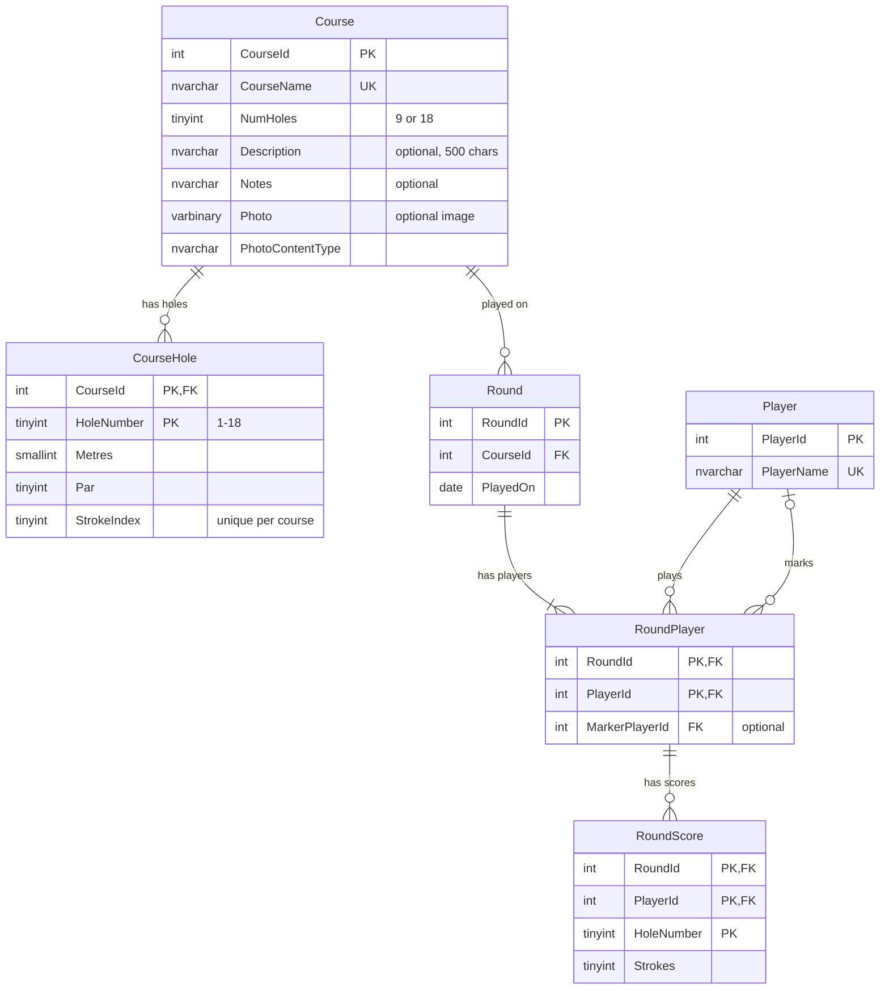

# Golf Stats Database

SQL Server Express database (`GolfStats`) for storing golf courses, players and their scores. Supports 9 or 18 hole courses.

## Scripts

Run in order, e.g. with `sqlcmd -S .\SQLEXPRESS -E -i <script>`.

| Script | Purpose |
| --- | --- |
| [01_create_schema.sql](01_create_schema.sql) | Creates the database, tables, constraints, validation trigger, views and stored procedures. Safe to re-run. |
| [02_seed_sample_data.sql](02_seed_sample_data.sql) | Adds three sample courses (9, 9 and 18 holes), three players and three rounds with scores. The Par 3 course uses holes 1-9 from the scorecard; its name is a placeholder. |

## Entity Relationship Diagram



`RoundScore.HoleNumber` is checked against the round's course by the `TR_RoundScore_ValidHole` trigger.

## Views and Procedures

| Object | Description |
| --- | --- |
| `vRoundScorecard` | Each score with the hole's metres, par, stroke index and score relative to par. |
| `vRoundSummary` | One row per round with holes scored, total par, total strokes and total to par. |
| `vPlayerCourseStats` | Per player per course: rounds played, best, average and last played (complete rounds only). |
| `usp_GetPlayerHistory @PlayerId, @CourseId = NULL` | A player's rounds, newest first, optionally filtered by course. |
| `usp_GetRoundScorecard @RoundId, @PlayerId = NULL` | Hole-by-hole card for one round, all players or one. |

## Example

```sql
INSERT INTO dbo.Player (PlayerName) VALUES (N'Player One');
INSERT INTO dbo.Player (PlayerName) VALUES (N'Player Two');
INSERT INTO dbo.Round (CourseId) VALUES (1);
INSERT INTO dbo.RoundPlayer (RoundId, PlayerId, MarkerPlayerId) VALUES (1, 1, 2), (1, 2, 1);
INSERT INTO dbo.RoundScore (RoundId, PlayerId, HoleNumber, Strokes) VALUES (1, 1, 1, 4), (1, 2, 1, 3);

EXEC dbo.usp_GetPlayerHistory @PlayerId = 1;
EXEC dbo.usp_GetRoundScorecard @RoundId = 1;
```
