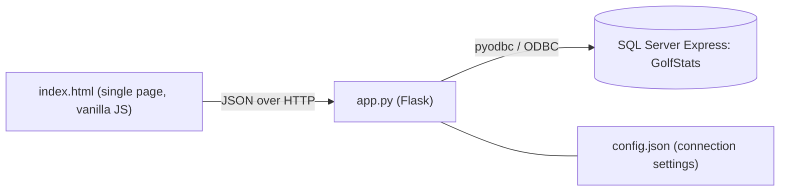

# Site Documentation

Technical documentation for the Golf Stats web app in [website/](../website/).

## Architecture



| File | Purpose |
| --- | --- |
| [website/index.html](../website/index.html) | The whole front end: HTML, CSS and JavaScript in one file with no external dependencies. |
| [website/app.py](../website/app.py) | Flask server. Serves the page, exposes the JSON API and talks to the database. |
| [website/requirements.txt](../website/requirements.txt) | Python dependencies: `flask` and `pyodbc`. |
| `website/config.json` | Created when settings are saved. Git-ignored. |

A browser cannot connect to SQL Server directly, so the Flask server sits between the page and the database. The page is one file served at `/`.

The data model is described in the [database README](../database/README.md).

## Running

```powershell
cd golf-stats-app\website
pip install -r requirements.txt
python app.py
```

The server listens on `127.0.0.1:5001` only. It uses Flask's development server in non-debug mode and does not reload on code changes.

## Configuration

Connection settings come from `config.json`, falling back to defaults:

| Setting | Default |
| --- | --- |
| `server` | `.\SQLEXPRESS` (or `GOLF_DB_SERVER`) |
| `database` | `GolfStats` |
| `driver` | `ODBC Driver 18 for SQL Server` (or `GOLF_DB_DRIVER`) |
| `auth` | `windows` (or `sql` with `username` and `password`) |
| `trust_server_certificate` | `true` |

Settings are edited in the app's **Settings** page. Each request reads the file, so a change takes effect immediately.

The connection string is built in `build_conn_str`. Every value is wrapped in braces with `}` escaped, so a value containing `;` cannot add extra connection attributes.

## API reference

All paths start with `/api`. Request and response bodies are JSON unless stated. Errors return `{"error": "message"}`.

### Read

| Method and path | Description |
| --- | --- |
| `GET /overview` | Totals, leaderboard, most played courses and recent rounds. |
| `GET /players` | All players with `HasPhoto`. |
| `GET /handicaps` | Current Handicap Index for each player id (`null` when not yet established). |
| `GET /players/<id>/handicap` | Handicap Index with its workings: scores used, course handicaps, ignored rounds. |
| `GET /players/<id>/photo` | Player photo bytes. `404` if none. |
| `GET /players/<id>/stats` | Course stats from `vPlayerCourseStats`. |
| `GET /players/<id>/history` | Rounds from `usp_GetPlayerHistory`. |
| `GET /courses` | Courses with description and `HasPhoto`. |
| `GET /courses/<id>` | One course including notes. |
| `GET /courses/<id>/holes` | Hole details for a course. |
| `GET /courses/<id>/photo` | Photo bytes with the stored content type. `404` if none. |
| `GET /rounds` | One summary row per player per round, newest first. |
| `GET /rounds/<id>/scorecard` | Hole-by-hole scores for every player in a round. |
| `GET /reports/player/<id>` | Player report data: `player`, `stats` (`vPlayerCourseStats`) and `rounds` (`vRoundSummary`). |
| `GET /reports/course/<id>` | Course report data: `course`, `holes` (`vCourseHoleStats`), `players` (`vPlayerCourseStats`) and `rounds` (`vRoundSummary`). |
| `GET /database/info` | Server, database, file sizes, table sizes and row counts, photo storage and the Express size limit. |

### Create and update

| Method and path | Body | Description |
| --- | --- | --- |
| `POST /players` | `{ "name" }` | Adds a player. Returns `PlayerId`. |
| `POST /courses` | `{ "name", "numHoles", "description", "notes", "courseRating", "slopeRating", "holes": [{ "hole", "metres", "par", "strokeIndex" }] }` | Adds a course and all its holes. Rating and slope are optional but needed for handicaps. Returns `CourseId`. |
| `PUT /courses/<id>` | `{ "description", "notes", "courseRating", "slopeRating" }` | Updates course details. |
| `PUT /courses/<id>/photo` | Raw image bytes with `Content-Type` of `image/jpeg`, `image/png` or `image/webp` | Stores or replaces the photo. |
| `DELETE /courses/<id>/photo` | None | Removes the photo. |
| `PUT /players/<id>/photo` | Raw image bytes (same types and size limit as course photos) | Stores or replaces a player's photo. |
| `DELETE /players/<id>/photo` | None | Removes a player's photo. |
| `POST /rounds` | `{ "courseId", "playedOn": "YYYY-MM-DD", "players": [{ "playerId", "markerPlayerId", "scores": [..] }] }` | Adds a round, its players and all scores. Returns `RoundId`. |

### Configuration

| Method and path | Description |
| --- | --- |
| `GET /config` | Current settings without the password, plus `has_password` and the installed SQL Server drivers. |
| `PUT /config` | Saves settings. A blank password keeps the saved one. |
| `POST /config/test` | Tries a connection with the supplied settings without saving. |

## Handicap calculation

The Handicap Index follows the World Handicap System, which Golf Australia uses (GA Handicap). The calculation lives in [website/handicap.py](../website/handicap.py). Each player's complete rounds are replayed in date order from `vRoundScorecard` and the course ratings, so the index always reflects the data in the database. It is calculated on request and is not stored.

**Inputs.** Each course needs a **course rating** and **slope rating** for the holes on its card (a 9-hole course uses its 9-hole values). Rounds on courses without them are ignored and listed in the handicap panel.

**Steps for each round:**

1. **Adjusted gross score.** Each hole is capped at net double bogey: par + 2 + the strokes the player receives on that hole. Strokes come from the player's course handicap and the hole's stroke index. Before a Handicap Index exists the cap is par + 5.
2. **Score differential** $= \frac{113}{\text{slope}} \times (\text{adjusted gross} - \text{course rating})$, rounded to one decimal. The Playing Conditions Calculation is treated as 0.
3. **9-hole rounds.** Without an index, two 9-hole rounds are added together in date order to make one 18-hole differential. With an index, a 9-hole differential is increased by the expected differential for the other nine, $0.52 \times \text{index} + 1.2$.
4. **Exceptional scores.** If a differential is at least 7.0 below the index, the most recent 20 differentials (including the new one) are reduced by 1.0. At least 10.0 below, by 2.0.
5. **Index.** A Handicap Index needs 3 differentials. It is the average of the lowest differentials from the last 20, plus an adjustment while fewer than 20 exist:

   | Scores | Lowest used | Adjustment |
   | --- | --- | --- |
   | 3 | 1 | -2.0 |
   | 4 | 1 | -1.0 |
   | 5 | 1 | 0 |
   | 6 | 2 | -1.0 |
   | 7 to 8 | 2 | 0 |
   | 9 to 11 | 3 | 0 |
   | 12 to 14 | 4 | 0 |
   | 15 to 16 | 5 | 0 |
   | 17 to 18 | 6 | 0 |
   | 19 | 7 | 0 |
   | 20 | 8 | 0 |

6. **Caps.** The index may rise by at most 3.0 above the lowest index of the previous 12 months before increases are halved (soft cap), and by no more than 5.0 in total (hard cap). The maximum index is 54.0.

**Course handicap** for a course $= \text{index} \times \frac{\text{slope}}{113} + (\text{course rating} - \text{par})$, rounded to the nearest whole number. For a 9-hole course the index is halved first.

This is an estimate for personal use. It is not an official Golf Australia handicap, which is issued through a club and its handicapping system. Ratings must come from the club's scorecard; the sample courses use made-up values.

## Validation and error handling

Input is checked on the server before anything is written:

- **Players:** name required, up to 100 characters.
- **Courses:** name required, 9 or 18 holes, exactly one entry per hole. Metres 1 to 2000, par 3 to 6, and stroke indexes between 1 and 18 that are all different. Description up to 500 characters, notes up to 5000. Course rating 18.0 to 90.0 and slope rating 55 to 155, entered together or not at all.
- **Rounds:** valid date, existing course, at least one player, no player repeated, and a score from 1 to 20 for every hole. A marker must be a different player in the same round.
- **Photos:** JPEG, PNG or WebP only, 1 byte to 2 MB. SVG is rejected because it can contain scripts. Responses carry `X-Content-Type-Options: nosniff`.

Creating a course or round runs in a single transaction and is rolled back if any step fails. The database constraints and the `TR_RoundScore_ValidHole` trigger are a second line of defence.

| Status | Meaning |
| --- | --- |
| `400` | Input failed validation. |
| `404` | Course or photo not found. |
| `409` | A unique or foreign key constraint was hit, for example a duplicate name. |
| `500` | The database could not be reached or another database error occurred. |

All SQL uses parameters, so user input is never concatenated into queries.

## Reports

Reports are rendered in the browser from the `/api/reports/*` endpoints, which read the database views (`vRoundSummary`, `vPlayerCourseStats` and `vCourseHoleStats`). **Print / Save as PDF** calls `window.print()`, so PDFs are produced by the browser's print dialog and no PDF library is needed. A `@media print` stylesheet hides the sidebar and controls and keeps table rows from splitting across pages. The page title is set to the report title while printing so the saved file gets a sensible name.

## Database information

`/api/database/info` reads `SERVERPROPERTY`, `sys.databases`, `sys.database_files`, `sys.tables`, `sys.partitions` and `sys.allocation_units`, plus `DATALENGTH` on the photo column. The Express 10 GB limit is applied to data files only (log files are excluded) and only when the edition name contains "Express".

## Theme

The theme is chosen in **Settings > Appearance** and stored in the browser's `localStorage` under `golf-stats-theme` (`dark`, `light` or `system`, defaulting to `system`). A small script at the top of `index.html` applies it before the page renders, setting `data-theme` on the `<html>` element. All colours are CSS variables defined in `:root`, and `html[data-theme="dark"]` overrides them. For `system`, a `prefers-color-scheme` listener updates the theme live. The page switches to the light theme while printing.

## Front end

`index.html` is organised as one function per page: `showOverview`, `showRounds`, `showPlayers`, `showCourses` (with `renderCourse`), `showReports`, `showSettings`, plus the forms `showAddCourse` and `showAddRound`. Every page uses the same layout: a top bar (`topBar`) holding the page's selector and main action button, then a profile card (`profileCard` and `badge`), then panels and tables. Small helpers (`api`, `sendJson`, `send`, `el`, `table`, `actionButton`) build the DOM. The icon is [website/favicon.svg](../website/favicon.svg), served at `/favicon.svg` (and `/favicon.ico` redirects to it) and also used as the logo in the sidebar. Text is always set through `textContent`, never `innerHTML`, so database values cannot inject markup.

The layout uses a sidebar for navigation and collapses to a top bar below 720px wide. Colours and spacing are CSS variables at the top of the file.

## Security notes

- There is no authentication. The server binds to `127.0.0.1` and should not be exposed to a network.
- A SQL login password is stored in plain text in `config.json`. Prefer Windows authentication, and do not commit the file (it is git-ignored).
- Run the app with a database account that has only the access it needs.

## Known limitations

- No edit or delete for players, rounds, holes or whole courses.
- Rounds must have every hole scored.
- Development server only; it is not intended for production use.
- Photos are stored in the database (`VARBINARY(MAX)`), which suits a handful of images. SQL Server Express has a 10 GB database size limit.
