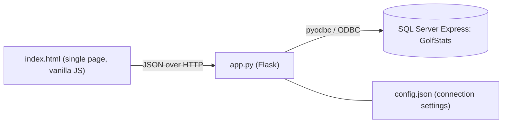

# Site Documentation

Technical documentation for the Golf Stats web app in [website/](../website/).

## Architecture



| File | Purpose |
| --- | --- |
| [website/index.html](../website/index.html) | The whole front end: HTML, CSS and JavaScript in one file with no external dependencies. |
| [website/app.py](../website/app.py) | Flask server. Serves the page, exposes the JSON API and talks to the database. |
| [website/requirements.txt](../website/requirements.txt) | Python dependencies: `flask` and `pyodbc`. |
| `website/config.json` | Created when settings are saved. Git-ignored. |

A browser cannot connect to SQL Server directly, so the Flask server sits between the page and the database. The page is one file served at `/`.

The data model is described in the [database README](../database/README.md).

## Running

```powershell
cd golf-stats-app\website
pip install -r requirements.txt
python app.py
```

The server listens on `127.0.0.1:5001` only. It uses Flask's development server in non-debug mode and does not reload on code changes.

## Configuration

Connection settings come from `config.json`, falling back to defaults:

| Setting | Default |
| --- | --- |
| `server` | `.\SQLEXPRESS` (or `GOLF_DB_SERVER`) |
| `database` | `GolfStats` |
| `driver` | `ODBC Driver 18 for SQL Server` (or `GOLF_DB_DRIVER`) |
| `auth` | `windows` (or `sql` with `username` and `password`) |
| `trust_server_certificate` | `true` |

Settings are edited in the app's **Settings** page. Each request reads the file, so a change takes effect immediately.

The connection string is built in `build_conn_str`. Every value is wrapped in braces with `}` escaped, so a value containing `;` cannot add extra connection attributes.

## API reference

All paths start with `/api`. Request and response bodies are JSON unless stated. Errors return `{"error": "message"}`.

### Read

| Method and path | Description |
| --- | --- |
| `GET /overview` | Totals, leaderboard, most played courses and recent rounds. |
| `GET /players` | All players. |
| `GET /players/<id>/stats` | Course stats from `vPlayerCourseStats`. |
| `GET /players/<id>/history` | Rounds from `usp_GetPlayerHistory`. |
| `GET /courses` | Courses with description and `HasPhoto`. |
| `GET /courses/<id>` | One course including notes. |
| `GET /courses/<id>/holes` | Hole details for a course. |
| `GET /courses/<id>/photo` | Photo bytes with the stored content type. `404` if none. |
| `GET /rounds` | One summary row per player per round, newest first. |
| `GET /rounds/<id>/scorecard` | Hole-by-hole scores for every player in a round. |

### Create and update

| Method and path | Body | Description |
| --- | --- | --- |
| `POST /players` | `{ "name" }` | Adds a player. Returns `PlayerId`. |
| `POST /courses` | `{ "name", "numHoles", "description", "notes", "holes": [{ "hole", "metres", "par", "strokeIndex" }] }` | Adds a course and all its holes. Returns `CourseId`. |
| `PUT /courses/<id>` | `{ "description", "notes" }` | Updates course details. |
| `PUT /courses/<id>/photo` | Raw image bytes with `Content-Type` of `image/jpeg`, `image/png` or `image/webp` | Stores or replaces the photo. |
| `DELETE /courses/<id>/photo` | None | Removes the photo. |
| `POST /rounds` | `{ "courseId", "playedOn": "YYYY-MM-DD", "players": [{ "playerId", "markerPlayerId", "scores": [..] }] }` | Adds a round, its players and all scores. Returns `RoundId`. |

### Configuration

| Method and path | Description |
| --- | --- |
| `GET /config` | Current settings without the password, plus `has_password` and the installed SQL Server drivers. |
| `PUT /config` | Saves settings. A blank password keeps the saved one. |
| `POST /config/test` | Tries a connection with the supplied settings without saving. |

## Validation and error handling

Input is checked on the server before anything is written:

- **Players:** name required, up to 100 characters.
- **Courses:** name required, 9 or 18 holes, exactly one entry per hole. Metres 1 to 2000, par 3 to 6, and stroke indexes between 1 and 18 that are all different. Description up to 500 characters, notes up to 5000.
- **Rounds:** valid date, existing course, at least one player, no player repeated, and a score from 1 to 20 for every hole. A marker must be a different player in the same round.
- **Photos:** JPEG, PNG or WebP only, 1 byte to 2 MB. SVG is rejected because it can contain scripts. Responses carry `X-Content-Type-Options: nosniff`.

Creating a course or round runs in a single transaction and is rolled back if any step fails. The database constraints and the `TR_RoundScore_ValidHole` trigger are a second line of defence.

| Status | Meaning |
| --- | --- |
| `400` | Input failed validation. |
| `404` | Course or photo not found. |
| `409` | A unique or foreign key constraint was hit, for example a duplicate name. |
| `500` | The database could not be reached or another database error occurred. |

All SQL uses parameters, so user input is never concatenated into queries.

## Front end

`index.html` is organised as one function per page: `showOverview`, `showRounds`, `showPlayers`, `showCourses`, `showCourse`, `showSettings`, plus the forms `showAddCourse` and `showAddRound`. Small helpers (`api`, `sendJson`, `send`, `el`, `table`, `pageHeader`) build the DOM. Text is always set through `textContent`, never `innerHTML`, so database values cannot inject markup.

The layout uses a sidebar for navigation and collapses to a top bar below 720px wide. Colours and spacing are CSS variables at the top of the file.

## Security notes

- There is no authentication. The server binds to `127.0.0.1` and should not be exposed to a network.
- A SQL login password is stored in plain text in `config.json`. Prefer Windows authentication, and do not commit the file (it is git-ignored).
- Run the app with a database account that has only the access it needs.

## Known limitations

- No edit or delete for players, rounds, holes or whole courses.
- Rounds must have every hole scored.
- Development server only; it is not intended for production use.
- Photos are stored in the database (`VARBINARY(MAX)`), which suits a handful of images. SQL Server Express has a 10 GB database size limit.
